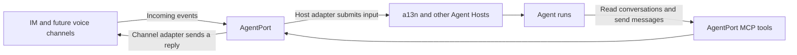

# AgentPort

[](https://github.com/saurlax/agentport/actions/workflows/ci.yml)
[](https://www.python.org/)
[](LICENSE)

**The communication gateway for AI agents.**

AgentPort is an open-source project for connecting AI agents to the places people
communicate. Incoming events can be routed to an Agent Host, while agents use MCP
tools to read conversations and act across channels. The goal is a reusable
communication layer: any channel, any agent.

Channel ingestion and Agent Host delivery have separate adapters. This allows a
conversation to reach an agent in a13n or another Host, while the agent can consult
other authorized channels before deciding where and how to respond.

> **Project status:** AgentPort is in its foundation stage. This repository
> contains a runnable HTTP service, a minimal management console, initial message
> models, and development tooling. Channel adapters, a13n delivery, persistence,
> and MCP tools are planned and are **not implemented yet**.

## How it fits together

The following diagram shows the intended integration flow. The adapters and
routing in the diagram are not available in the initial scaffold.



- **Connect channels.** Receive platform events through channel adapters, starting
  with a planned OneBots integration. Telephone and radio require separate media
  and session adapters; they are future directions.
- **Deliver to agents.** Bind channel conversations to Agent Host threads and
  submit input through the Host's supported API. MCP notifications alone do not
  create or wake an Agent run.
- **Give agents communication tools.** Expose conversation reads and channel
  actions through MCP, with access scoped to the authorized channels.
- **Embed or run separately.** Keep reusable Python behavior independent of the
  HTTP server and optional console so it can later be embedded in a Host.

AgentPort is independent of [Agent Foundation (a13n)](https://github.com/converge-ai-labs/agent-foundation)
and [OneBots](https://github.com/lc-cn/onebots). The initial development layout
follows a13n's Python/uv and React/TypeScript/Vite approach.

## Run from source

You need **Python 3.13**, [**uv**](https://docs.astral.sh/uv/), **Make**, **Node.js 24
or later**, and **pnpm 10.34.5** for the console. There are no published packages or
container images yet.

```bash
git clone https://github.com/saurlax/agentport.git
cd agentport
make install
make serve
```

Open **<http://127.0.0.1:8310>** for the console and
**<http://127.0.0.1:8310/api/docs>** for the API documentation. The console displays
live service availability and the planned integrations. It does not connect real
accounts or route messages yet. Stop the foreground service with `Ctrl+C`.

To run only the backend, without Node.js or pnpm:

```bash
uv sync --locked
uv run --locked agentport serve
```

The backend exposes `GET /healthz`, `GET /api/v1/status`, and
`GET /api/openapi.json`. It serves the console only when frontend assets are
present. Run `uv run agentport serve --help` for listen options.

The initial service binds to loopback and has no authentication; use it for local
development.

## Develop

Python packages are managed by a uv workspace. The private frontend uses a pnpm
workspace, with compiled assets bundled into the server package. Node.js is needed
to build the console, not to run a built Python package.

| Work on | Command |
| --- | --- |
| Install locked dependencies | `make install` |
| Backend with reload | `make dev-api` |
| Frontend with hot reload | `make dev-web` |
| Serve the built console and backend | `make serve` |
| Formatting, lint, and type checks | `make check` |
| Backend and core tests | `make test` |
| Console and Python package builds | `make build` |

Run `make dev-api` and `make dev-web` in separate terminals. The frontend at
`http://127.0.0.1:5173` proxies API requests to the backend at
`http://127.0.0.1:8310`.

```text
packages/
  agentport-core/      Reusable channel addresses and text message models
  agentport-server/    FastAPI application, CLI, and optional console assets
frontend/
  apps/console/       React + TypeScript + Vite management console
```

See [CONTRIBUTING.md](CONTRIBUTING.md) for setup and validation and
[DEVELOPMENT.md](DEVELOPMENT.md) for component boundaries and engineering standards.

## Contribute

Bug reports, documentation improvements, and focused integrations are welcome.
Search [GitHub Issues](https://github.com/saurlax/agentport/issues) before opening a
proposal. Discuss routing semantics, delivery guarantees, and new adapter
contracts before implementing them. Keep implementation claims aligned with the
code that users can run.

For private vulnerability reports, follow [SECURITY.md](SECURITY.md).

## License

AgentPort is licensed under the [Apache License 2.0](LICENSE).

Copyright 2026 Saurlax.
