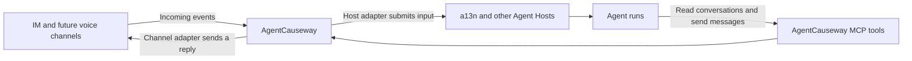

# AgentCauseway

[](https://github.com/saurlax/agentcauseway/actions/workflows/ci.yml)
[](https://www.python.org/)
[](LICENSE)

**The communication gateway for AI agents.**

AgentCauseway is an open-source project for connecting AI agents to the places people
communicate. Incoming events can be routed to an Agent Host, while agents use MCP
tools to read conversations and act across channels. The goal is a reusable
communication layer: any channel, any agent.

Channel ingestion and Agent Host delivery have separate adapters. This allows a
conversation to reach an agent in a13n or another Host, while the agent can consult
other authorized channels before deciding where and how to respond.

> **Project status:** A text bridge from OneBot v11, QQ official Bot, and Weixin iLink
> to a13n is implemented, with verified event ingestion, conversation routes, persistent delivery records,
> scoped MCP tools, generic MCP client Hosts with independent keys, and a management console built from official shadcn blocks.
> Cross-channel identity linking, full RBAC, moderation actions, and voice/radio
> integrations remain planned. This is a single-process prototype.

## How it fits together

The implemented bridge separates channel ingestion, host execution, and
agent-facing communication tools. Restricted group replies pass through administrator approval; explicit full-access routes can reply automatically.



- **Connect channels.** Receive platform events through channel adapters, starting
  with OneBot v11 HTTP/WebSocket transports, QQ official Gateway/callbacks, and
  Weixin iLink QR pairing/long polling. Telephone and radio require separate media
  and session adapters; they are future directions.
- **Deliver to agents.** Bind channel conversations to Agent Host threads and
  submit input through the Host's supported API. MCP notifications alone do not
  create or wake an Agent run.
- **Give agents communication tools.** Expose conversation reads and channel
  actions through MCP, with access scoped to the authorized channels.
- **Embed or run separately.** Keep reusable Python behavior independent of the
  HTTP server and optional console so it can later be embedded in a Host.

AgentCauseway is independent of [Agent Foundation (a13n)](https://github.com/converge-ai-labs/agent-foundation)
and [OneBots](https://github.com/lc-cn/onebots). The initial development layout
follows a13n's Python/uv and React/TypeScript/Vite approach.

## Run from source

You need **Python 3.13**, [**uv**](https://docs.astral.sh/uv/), **Make**, **Node.js 24
or later**, and **pnpm 10.34.5** for the console. There are no published packages or
container images yet.

```bash
git clone https://github.com/saurlax/agentcauseway.git
cd agentcauseway
make install
export AC_ADMIN_USERNAME=admin
export AC_ADMIN_PASSWORD='replace-with-your-password'
make serve
```

Open **<http://127.0.0.1:8310>** for the console and
**<http://127.0.0.1:8310/api/docs>** for the API documentation. The console displays
separate channel and Agent Host panels, conversation routes, received messages,
and reply approvals. Management pages use a search toolbar and table; Add and
row actions open dialogs. Sign in
with the account and password you configured. Follow the
[OneBots and a13n setup guide](docs/onebots-a13n.md) or the
[QQ and Weixin guide](docs/official-channels.md) to connect real accounts.
The [Agent Host guide](docs/agent-hosts.md) covers API + MCP and generic MCP clients.
Adding a channel starts with protocol selection; each addition binds one account.

The console follows the browser's language preferences automatically. It supports
English and Simplified Chinese, choosing the first supported language and falling
back to English. Chinese language variants currently use Simplified Chinese.
Channel messages, user-defined names, and identifiers remain in their original
language.
Stop the foreground service with `Ctrl+C`.

To run only the backend, without Node.js or pnpm:

```bash
uv sync --locked
export AC_ADMIN_USERNAME=admin
export AC_ADMIN_PASSWORD='replace-with-your-password'
uv run --locked agentcauseway serve
```

The backend exposes `GET /healthz`, `GET /api/v1/status`, and
`GET /api/openapi.json`. It serves the console only when frontend assets are
present. Run `uv run agentcauseway serve --help` for listen options.

The service binds to loopback by default. Management requires a configured
administrator username and a password of at least 8 characters. When both are unset,
health and status remain available but management is disabled; configuring only
one refuses startup. Login uses an
HttpOnly session cookie, survives page refresh, and expires after 12 hours or
service restart. Sign-out revokes the session. MCP uses separate Host/route keys. SQLite state defaults to `.agentcauseway/`; set
`AC_DATA_DIR` to a persistent private directory when hosting the service.
Credentials and message history are stored there, without encryption at rest.
Use one process and one replica. Expose authenticated endpoints through HTTPS.

## Environment variables

AgentCauseway supports exactly three environment variables:

| Variable            | Purpose                                         | Default          |
| ------------------- | ----------------------------------------------- | ---------------- |
| `AC_ADMIN_USERNAME` | Administrator login account                     | Unset            |
| `AC_ADMIN_PASSWORD` | Administrator login password, 8-4096 characters | Unset            |
| `AC_DATA_DIR`       | Private persistent state directory              | `.agentcauseway` |

See [.env.example](.env.example). Export these values before running Make, or
load a private environment file explicitly:

```bash
uv run --locked --env-file .env agentcauseway serve
```

Choose your own password before starting; there is no built-in account or password.
Passwords must contain at least 8 characters in every deployment.
The server reads only `AC_` names; the previous `AGENTCAUSEWAY_` variables and
administrator token are removed. Listener host and port remain CLI options
(`--host`, `--port`), not additional environment variables. Keep the same
`AC_DATA_DIR` when upgrading to preserve channels, credentials, and history.

## Develop

Python packages are managed by a uv workspace. The private frontend uses a pnpm
workspace, with compiled assets bundled into the server package. Node.js is needed
to build the console, not to run a built Python package.

| Work on                             | Command        |
| ----------------------------------- | -------------- |
| Install locked dependencies         | `make install` |
| Backend with reload                 | `make dev-api` |
| Frontend with hot reload            | `make dev-web` |
| Serve the built console and backend | `make serve`   |
| Formatting, lint, and type checks   | `make check`   |
| Backend and core tests              | `make test`    |
| Console and Python package builds   | `make build`   |

Run `make dev-api` and `make dev-web` in separate terminals. The frontend at
`http://127.0.0.1:5173` proxies API requests to the backend at
`http://127.0.0.1:8310`.

```text
packages/
  agentcauseway-core/    Reusable channel addresses and text message models
  agentcauseway-server/  FastAPI application, CLI, and optional console assets
frontend/
  apps/console/         React + TypeScript + Vite management console
```

See [CONTRIBUTING.md](CONTRIBUTING.md) for setup and validation and
[DEVELOPMENT.md](DEVELOPMENT.md) for component boundaries and engineering standards.
The [specification index](spec/README.md) leads to the accepted architecture,
channel, access, delivery, and Agent tool contracts. User setup instructions live
in `docs/`; unresolved designs and plans belong in GitHub Issues.

## Contribute

Bug reports, documentation improvements, and focused integrations are welcome.
Search [GitHub Issues](https://github.com/saurlax/agentcauseway/issues) before opening a
proposal. Discuss routing semantics, delivery guarantees, and new adapter
contracts before implementing them. Keep implementation claims aligned with the
code that users can run.

For private vulnerability reports, follow [SECURITY.md](SECURITY.md).

## License

AgentCauseway is licensed under the [Apache License 2.0](LICENSE).

The console includes MIT-licensed [shadcn/ui](https://github.com/shadcn-ui/ui)
components and the official [sidebar-07](https://ui.shadcn.com/blocks/sidebar) and
[login-01](https://ui.shadcn.com/blocks/authentication) blocks. Their license is
retained in the frontend and bundled assets.

Copyright 2026 Saurlax.
