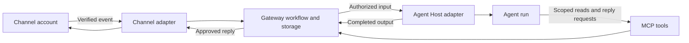

# Architecture

## Components

| Component          | Responsibility                                                             |
| ------------------ | -------------------------------------------------------------------------- |
| Core               | Reusable channel addresses and text message models                         |
| Channel adapter    | Authenticate/project platform events and execute channel operations        |
| Agent Host adapter | Submit input and observe execution through the Host's public APIs          |
| Gateway workflow   | Authorize routes, persist work, bind conversations, and coordinate replies |
| MCP tools          | Expose reads and reply requests within a credential's authorized scope     |
| Server             | Management API, storage, listeners, and process startup/shutdown           |
| Console            | Authenticated management views and actions through the server API          |

Core depends on neither FastAPI, a13n, nor a channel SDK. The server currently
contains both adapters and workflow; the table describes responsibilities, not
separate deployed services. Importing a library starts no listeners, reads no
credentials, and configures no process logging. External I/O is asynchronous;
storage transactions never span external calls, Agent execution, or waits.

Ingestion, Host acceptance, run completion, reply approval, and confirmed channel
sending are distinct boundaries. Their durable meanings are owned by
[routing and delivery](03-routing-and-delivery.md). MCP transport does not own
the lifecycle that starts an idle Agent run.

## Management surface

The current management API uses `/api/v1`. Channel accounts and Agent Hosts share
a connection resource with channel `kind: onebots`, `qq`, or `weixin`, and Host
`kind: a13n` or `mcp`; that wire representation
does not merge their domain roles. The console exposes separate Channels and
Agent hosts pages, followed by route, message, and reply management.

| API group                                      | Operations                                                               |
| ---------------------------------------------- | ------------------------------------------------------------------------ |
| `/auth/login`, `/auth/session`, `/auth/logout` | Administrator login, session restoration, and revocation                 |
| `/connections`                                 | List/create connections, replace credentials, rotate Host MCP keys       |
| `/routes`                                      | List/create routes, update access/binding, and rotate route tokens       |
| `/events`                                      | List accepted messages and retry failed input delivery                   |
| `/replies`                                     | List replies, approve edited drafts, and reject drafts                   |
| `/hooks/onebots/{connection_id}`               | Receive account-specific signed OneBot events                            |
| `/hooks/qq/{connection_id}`                    | Validate and receive signed official QQ callbacks                        |
| `/ws/onebots/{connection_id}`                  | Accept an authenticated reverse universal WebSocket                      |
| `/connections/{id}/login`                      | Start administrator Weixin QR pairing; `/status` and `/cancel` manage it |

`/healthz`, `/api/v1/status`, and generated API documentation are public. Health
is a process response, not proof of upstream connectivity or successful message
delivery. Management operations require [administrator authentication](02-identity-and-access.md).
The optional console calls these operations; it owns no independent routing or
authorization rules. [DEVELOPMENT.md](../DEVELOPMENT.md#console-management-patterns)
owns console interaction standards.

## Runtime and persistence

The supported topology is one process and one replica. SQLite persists connections,
routes, received messages, Host submission receipts, and replies across restart.
It has no distributed worker leases, schema migration framework, retention
policy, or high-availability contract. HTTP callbacks acknowledge authorized
input after local persistence; no external exactly-once effect is promised.

The standalone server owns listeners and shutdown. The frontend is optional;
headless installations expose the same gateway operations. Static console assets
are bundled into the server package when built, and an installed package requires
no Node.js to serve them. Reusable models remain independent of the server so
future embedding does not require a second domain model. This baseline does not
declare a stable public embedding or adapter API.
