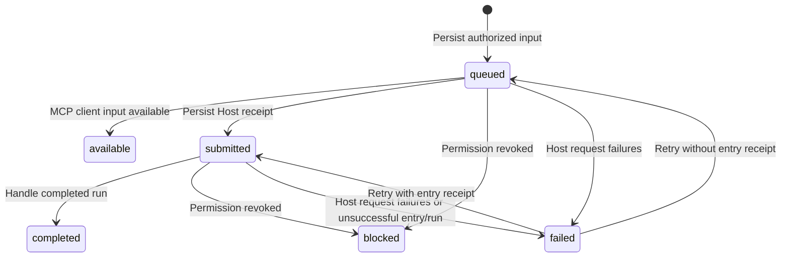

# Routing and delivery

## Conversation routes

A route binds one channel connection, conversation kind (`private` or `group`),
and conversation ID to one Agent Host connection. An `a13n` Host requires an
agent ID; a generic `mcp` Host has no upstream agent ID or thread binding. That source tuple
is unique; it cannot fan out to several routes. URLs and routing destinations
are immutable through the management API. Access and MCP binding are mutable
within the [authorization contract](02-identity-and-access.md).

For an `a13n` Host, the first submitted input creates an a13n thread and its session. The returned
thread is persisted on the route. Subsequent inputs enter that thread's inbox;
different conversations never intentionally share threads. Only the oldest
queued/submitted input per route advances, preserving attribution of a run's
output to its source input. This is per-route sequencing, not concurrent or
distributed worker scheduling.

Administrator-only `DELETE /api/v1/routes/{id}` removes an active route and any
concrete children of an all-conversation parent. One transaction blocks pending
inputs and queued replies, clears their private incoming reply contexts, archives
the source identity, policy and thread binding without token hashes, and releases
the account/conversation uniqueness constraint. Removed route tokens no longer
authorize MCP. Historical received messages, observations, replies, and receipts
remain readable through administrator conversation history. Recreating the same
source creates a new route identity and thread binding; it does not replay old
inputs or restore an archived token. In-flight external requests or Agent runs
cannot be retracted. Creating routes or children and updating bindings recheck
resource existence in their storage transaction so deletion cannot be undone by
a stale configuration write.

## All-conversation routes and identity discovery

`conversation_id: "*"` creates an all-conversation route for one channel account
and conversation kind. A specific route takes priority, even when disabled or
its sender policy denies the input; denial never falls back to a broader route.
When an authorized new conversation matches `*`, CG persists a concrete child
route with `parent_route_id`. Each child has a separate thread and input queue.
Its enabled state and sender, permission, reply policies are rechecked against
its parent at every authorization boundary. Parent edits apply to existing
children; child access cannot be independently edited. The console lists parent
configuration; management API views also expose concrete children and bindings.
The source tuple remains unique and cannot fan out.
MCP listing also materializes authorized previously observed conversations under
an enabled `*` route, without queuing old inputs or creating upstream threads.
Existing exact routes take priority even when disabled or assigned to another
Host; history discovery cannot override that assignment.

All-conversation a13n routes use final-output replies and cannot bind a single
dedicated a13n MCP connection across their children. Generic MCP routes support
this scope through concrete route IDs. Existing exact routes retain their
bindings and default restricted/allowlist behavior without schema rewrites.

Verified supported messages without a route appear in management as `unmatched`,
with nullable `route_id`. Denied ingress appears as `blocked`, also without a
route binding. Both are durable administrator observations, deduplicated by the
same account/conversation/source-message identity as delivered inputs. They
never enter the worker queue. MCP can read their text after the source
conversation and sender are authorized by its current route. Adding a route or
provider redelivery does not replay them as Agent work. A new message is required
to trigger execution after configuration.
Earlier messages discarded by older versions cannot be recovered from local
state. Pairing credentials and reply-context tokens are never included in these
observations.

Channel collection precedes routing: every bounded authenticated packet is
retained under the [channel-event journal contract](01-channel-adapters.md#route-independent-event-retention),
including events that cannot be projected to a supported text message. Route
selection controls Agent delivery and capability access, never packet retention.

## Input lifecycle

| Durable state | Meaning                                                                                   |
| ------------- | ----------------------------------------------------------------------------------------- |
| `queued`      | Authorized input is persisted; Host acceptance is not confirmed                           |
| `available`   | Input is locally available to an MCP client; no Host receipt or run completion is implied |
| `submitted`   | a13n accepted the input; its run may still be queued, running, or waiting                 |
| `completed`   | The assigned run completed and its output was handled                                     |
| `blocked`     | Current route/source authorization prevents further processing                            |
| `failed`      | Host operations exhausted the failure limit, or entry/run processing ended unsuccessfully |

Before the first submission attempt, CG persists the target path and complete
request body. Creation uses `POST /threads`; continuation uses
`POST /threads/{thread_id}/inbox`, with `delivery: next_run`. The event ID is the
stable `Idempotency-Key`. A lost receipt retries the same target, body, and key,
even when configuration or thread observations change later.

A submission receipt records the thread, inbox entry, and optional run ID.
Without a run ID, CG polls that exact entry for assignment, then polls its run.
Host acceptance does not prove execution completion. Accepted, running, and
waiting runs remain `submitted`; waiting work is resolved in a13n.

Host request/parsing failures increment attempts; five failures mark the event
`failed`. Valid run observations reset that failure counter. Administrator retry
resets attempts and resumes submission or polling based on the persisted entry
receipt; it preserves a frozen submission request. Replacement a13n keys must
retain the same upstream principal/workspace for the upstream idempotency scope
to remain valid.

For `reply_source: output`, a completed output creates at most one event-linked
reply. Only a nonempty string or an object with a nonempty `text` string is
supported, with at most 16000 characters. Unsupported/oversized output completes
the event with a diagnostic and no reply. Arbitrary structured data is not
serialized into a channel message. For `reply_source: mcp`, run completion does
not create an additional output reply; [MCP tools](04-agent-tools.md) own requests.

## Generic MCP delivery

A `mcp` Host has no API endpoint or upstream key. Its routes require
`reply_source: mcp` and reject a13n agent/MCP-connection bindings. The worker
reauthorizes each queued event and marks it `available` without external I/O,
thread creation, or run tracking. Subsequent queued events can advance once the
oldest event is available. Reads do not acknowledge, consume, or complete events;
clients choose their own polling and deduplication strategy using source message
identities. Available history is always filtered by current access at tool time.

No MCP notification, background client wakeup, or autonomous client run is
promised. Clients request replies through MCP under the current route authorization rules.
The gateway cannot infer that a client has finished processing a message.

## Reply lifecycle

| Durable state | Meaning                                                                |
| ------------- | ---------------------------------------------------------------------- |
| `queued`      | Text awaits automatic sending after current authorization checks       |
| `sending`     | CG claimed the reply and may have issued the external request          |
| `sent`        | A confirmed channel acceptance receipt is persisted                    |
| `blocked`     | Route or linked-source authorization prevents sending                  |
| `unknown`     | Delivery may have happened, but CG has no confirmed successful outcome |

Both completed Agent output and MCP reply requests create queued replies for
private and group conversations. There is no approve/reject API or manual review
step. Permission mode controls a13n connection-tool selection, not sending policy.
The worker rechecks route/source access, claims a queued reply, and issues one
channel request. Disabling the route or revoking a linked input's sender blocks
pending replies before sending.

OneBot and QQ receipts contain platform message IDs; Weixin acceptance receipts
use CG's client ID because the provider returns no platform message ID. `sent`
does not prove recipient delivery/reading. Offline OneBot sockets and unpaired
Weixin accounts leave replies `queued` until ready. Missing authorized native
reply context becomes `blocked` before any send request; native platform reply
windows still apply. [Channel adapters](01-channel-adapters.md) owns these protocol
constraints and private context handling.

A timeout, rejected/malformed receipt, or interrupted sending request produces
`unknown`; the baseline conservatively does not assume that such an operation is
safe to repeat. On restart, persisted `sending` replies become `unknown`. Unknown
replies are never automatically retransmitted, and no manual resend operation is
defined. Verify the channel before separately deciding whether another message is
necessary.

For existing databases, startup converts previously approved replies to `queued`
and retires unreviewed drafts as `blocked` with a diagnostic; old drafts are never
silently sent. Historical rejected, sent, blocked, and unknown records remain
unchanged. Stored `auto_reply` settings are removed without changing sender access
or Agent tool permission mode. New route inputs and updates reject that removed
field. The console includes outgoing records in message conversation history, without
reply editing, decisions, or a separate reply page.

Input deduplication and Host idempotency do not imply exactly-once channel replies.
Channel sending provides no external idempotency guarantee in this baseline.
Queued replies, thread binding, and confirmed receipts survive restart without
resending completed work.

## Administrator conversation history

`GET /api/v1/history` requires an administrator session and the exact
`channel_id`, `conversation_kind`, and `conversation_id`. It merges accepted
incoming events, unmatched/blocked observations, and replies for that source
account and concrete conversation. Incoming records have direction `incoming`;
replies have direction `outgoing`. Parent all-conversation routes are not history
destinations: Messages lists concrete conversations separately.

Records expose ID, route ID, text, sender ID for incoming messages, delivery state,
error, creation time, and any thread/run identifiers. They expose no credentials,
private reply contexts, or frozen Host request bodies. Legacy incoming events
without an address use their retained route's source identity. This is an
administrator history API, independent of MCP capabilities; MCP conversation
reads continue to return authorized incoming messages only.

History uses persistence creation time and ID for deterministic chronological
ordering. Each request reads the newest 100 records by default, with `limit`
bounded to 1–100, and returns `messages` in ascending order plus `has_more`.
Earlier pages require both `before_created_at` and `before_id` from the oldest
record of the current page; the cursor uses an exclusive comparison. The console
can load earlier messages and refresh the latest page without duplicating entries.
The conversation overview combines recent activity with enabled concrete routes,
so older route histories remain accessible. Conversation history opens only from
Messages; route rows expose one Edit action with token rotation and enable/disable
settings inside its dialog. Failed incoming deliveries retain their administrator
retry action in conversation history.
