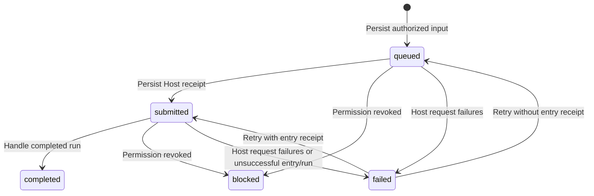

# Routing and delivery

## Conversation routes

A route binds one channel connection, conversation kind (`private` or `group`),
and conversation ID to one Agent Host connection and agent ID. That source tuple
is unique; it cannot fan out to several routes. URLs and routing destinations
are immutable through the management API. Access and MCP binding are mutable
within the [authorization contract](02-identity-and-access.md).

The first submitted input creates an a13n thread and its session. The returned
thread is persisted on the route. Subsequent inputs enter that thread's inbox;
different conversations never intentionally share threads. Only the oldest
queued/submitted input per route advances, preserving attribution of a run's
output to its source input. This is per-route sequencing, not concurrent or
distributed worker scheduling.

## Input lifecycle

| Durable state | Meaning                                                                                   |
| ------------- | ----------------------------------------------------------------------------------------- |
| `queued`      | Authorized input is persisted; Host acceptance is not confirmed                           |
| `submitted`   | a13n accepted the input; its run may still be queued, running, or waiting                 |
| `completed`   | The assigned run completed and its output was handled                                     |
| `blocked`     | Current route/source authorization prevents further processing                            |
| `failed`      | Host operations exhausted the failure limit, or entry/run processing ended unsuccessfully |

Before the first submission attempt, AC persists the target path and complete
request body. Creation uses `POST /threads`; continuation uses
`POST /threads/{thread_id}/inbox`, with `delivery: next_run`. The event ID is the
stable `Idempotency-Key`. A lost receipt retries the same target, body, and key,
even when configuration or thread observations change later.

A submission receipt records the thread, inbox entry, and optional run ID.
Without a run ID, AC polls that exact entry for assignment, then polls its run.
Host acceptance does not prove execution completion. Accepted, running, and
waiting runs remain `submitted`; waiting work is resolved in a13n.

Host request/parsing failures increment attempts; five failures mark the event
`failed`. Valid run observations reset that failure counter. Administrator retry
resets attempts and resumes submission or polling based on the persisted entry
receipt; it preserves a frozen submission request. Replacement a13n keys must
retain the same upstream principal/workspace for the upstream idempotency scope
to remain valid.

For `reply_source: output`, a completed output creates at most one event-linked
reply. Only a nonempty string or an object with a nonempty `text` string is
supported, with at most 16000 characters. Unsupported/oversized output completes
the event with a diagnostic and no reply. Arbitrary structured data is not
serialized into a channel message. For `reply_source: mcp`, run completion does
not create an additional output reply; [MCP tools](04-agent-tools.md) own requests.

## Reply lifecycle

| Durable state | Meaning                                                                |
| ------------- | ---------------------------------------------------------------------- |
| `draft`       | Text awaits administrator review                                       |
| `approved`    | Text is eligible for sending after current authorization checks        |
| `rejected`    | Administrator rejected the draft                                       |
| `sending`     | AC claimed the reply and may have issued the external request          |
| `sent`        | A successful OneBot message receipt is persisted                       |
| `blocked`     | Route or linked-source authorization prevents sending                  |
| `unknown`     | Delivery may have happened, but AC has no confirmed successful outcome |

Group replies always begin as drafts. Private replies begin approved only when
the route explicitly enables automatic replies. An administrator can edit and
approve, or reject, an existing draft; a non-draft decision returns a conflict.
Approval does not itself prove sending.

The worker rechecks route/source access, claims an approved reply, and issues one
channel request. A timeout, rejected/malformed receipt, or interrupted sending
request produces `unknown`; the baseline conservatively does not assume that
such an operation is safe to repeat. On restart, persisted `sending` replies
become `unknown`. Unknown replies are never automatically retransmitted, and no
manual resend operation is defined. Verify the channel before separately deciding
whether another message is necessary.

Input deduplication and Host idempotency do not imply exactly-once channel replies.
OneBot sending provides no idempotency guarantee in this baseline. Persisted
drafts, thread binding, and confirmed receipts survive restart without resending
completed work.
